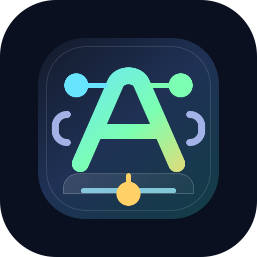

# Frontend Agent Admin



Frontend Agent Admin 是一款面向开发者的本地 AI Agent 开发辅助平台。它将需求分析、技术选型、Agent 分工、代码生成、代码审核、调试修复、测试构建和交付文档串联成一套完整的项目开发工作流，帮助开发者更高效、更可控地完成前端、后端和全栈项目开发。

平台采用 Electron + React + TypeScript + Vite + Ant Design 开发，内置 Node.js 本地服务，支持 Windows 和 macOS 桌面应用打包。

## 产品定位

Frontend Agent Admin 不是一个单点代码生成器，而是一个本地 AI Agent 开发工作台。

它适合用来：

- 从自然语言需求生成可执行开发计划
- 自动分析项目是否需要前端、后端、数据库和服务器配置
- 根据项目需求推荐技术选型
- 调度多个专项 Agent 协作完成开发流程
- 生成真实可运行的项目代码
- 审核代码规范、引用异常、测试缺口和构建风险
- 执行本地测试、构建和交付文档整理
- 使用本地模型完成离线或半离线开发辅助

## 核心价值

- 降低项目从 0 到 1 的启动成本。
- 避免需求、架构、文件拆分、测试构建中的遗漏。
- 将大模型能力从“聊天生成代码”升级为“流程化开发执行”。
- 保留人工确认机制，避免敏感配置和高风险操作被自动执行。
- 支持本地 JSON 数据存储，不依赖外部数据库。
- 支持本地 Ollama 模型，也可以扩展线上模型。

## 技术架构

| 模块 | 技术 |
| --- | --- |
| 桌面客户端 | Electron |
| 前端 | React + TypeScript + Vite |
| UI | Ant Design |
| 本地服务 | Node.js + TypeScript |
| 数据存储 | 本地 JSON 文件 |
| 模型接入 | Ollama 本地模型、线上模型 |
| 打包 | electron-builder |
| 支持平台 | Windows、macOS |

## 客户端设计

平台分为主客户端和子客户端。

### 主客户端

主客户端负责全局管理和项目配置。

主要功能：

- 首页统计
- 项目中心
- 模型配置
- Agent 配置
- 系统设置
- 项目创建与导入
- 项目模型绑定
- 项目路径配置
- 数据库和服务器配置
- 打开或关闭项目子客户端

主客户端中只做全局配置和项目基础配置，不直接承载具体开发过程。

### 子客户端

子客户端负责单个项目的具体开发执行。

主要功能：

- Agent 任务规划
- 技术选型确认
- 数据库/服务器配置提醒
- 开发工作流执行
- 文件变更查看与应用
- 项目文件浏览
- 项目运行、测试、构建
- 日志查看
- 交付文档生成

一个项目同一时间只能打开一个子客户端，避免重复执行和状态冲突。

## 核心功能

### 1. 首页统计

首页用于展示平台整体运行情况，包括：

- 项目数量统计
- 模型使用量趋势
- Agent 使用量统计
- 最近运行项目
- 待处理异常

首页用于快速了解当前平台状态和近期任务情况。

### 2. 项目中心

项目中心用于管理所有开发项目。

支持：

- 新建项目
- 导入项目
- 编辑项目
- 查看项目详情
- 删除项目配置
- 打开子客户端
- 关闭子客户端
- 选择项目模型
- 配置项目路径
- 管理项目状态

创建项目时，用户只需要填写基础信息：

- 项目名称
- 项目路径
- 使用模型
- 项目描述
- 项目需求
- 项目约束

平台不会要求用户在创建阶段提前确定所有技术细节。是否需要前端、后端、数据库、服务器等能力，会在子客户端中由主调度分析后给出建议。

### 3. 模型配置

模型配置用于管理本地模型和线上模型。

支持配置：

- 模型名称
- 模型类型
- 模型提供方
- Base URL
- Model ID
- 上下文长度
- 最大输出长度
- 超时时间
- 是否启用
- 是否健康
- 是否支持结构化输出
- 是否支持代码生成
- 是否支持流式输出

本地模型主要通过 Ollama 接入。添加本地模型时，平台会扫描本地 Ollama 服务和已安装模型，避免添加不存在的模型。

### 4. Agent 配置

Agent 配置用于维护专项 Agent。

平台内置 Agent 包括：

- 需求分析 Agent
- 架构设计 Agent
- 文件拆分 Agent
- 前端开发 Agent
- 后端开发 Agent
- 代码审核 Agent
- 调试修复 Agent
- 测试构建 Agent
- 文档 Agent
- 上下文整理 Agent

每个 Agent 支持配置：

- Agent 名称
- Agent 分类
- 使用模型
- 风险等级
- 是否启用
- Agent 描述
- 角色 Prompt
- 工具权限
- 审批规则
- 上下文规则
- 输出格式
- 质量门禁

### 5. 主调度机制

主调度 Agent 是平台内部概念，不是一个可创建的普通 Agent。

它负责：

- 分析用户原始需求
- 判断是否需要前端
- 判断是否需要后端
- 判断是否需要数据库
- 判断是否需要服务器配置
- 推荐技术选型
- 分配专项 Agent
- 生成 Agent 任务清单
- 根据用户修改后的规划重新分析

如果模型输出与用户明确约束冲突，服务端会做确定性兜底。例如需求明确写了 MySQL、数据库、建表、测试数据或持久化，平台会强制识别为需要数据库；需求明确要求 Java 或非 Node 后端时，平台会修正后端选型，避免误生成 Node + Express。

### 6. Agent 任务规划

打开子客户端后，首先进入 Agent 任务规划页面。

主调度会根据需求输出：

- 项目范围判断
- 前端/后端/数据库/服务器能力判断
- 技术选型推荐
- 需要参与的 Agent 列表
- 每个 Agent 的任务说明
- 缺失配置提醒
- 待确认问题

如果项目需要数据库但尚未配置，页面会提示用户配置数据库。

### 7. 技术选型确认

主调度会推荐技术选型，例如：

```text
前端框架：Vue 3 + TypeScript + Vite
后端运行时与框架：Java JDK HttpServer
数据库：MySQL
```

用户可以确认，也可以修改。

确认后的技术选型会作为后续需求分析、架构设计、代码生成、测试构建和文档输出的约束。

### 8. 开发工作流

子客户端内置完整开发流程。

默认 9 个节点：

1. 需求分析
2. 架构设计
3. 开发计划
4. 前端开发
5. 后端开发
6. 代码审核
7. 调试修复
8. 测试构建
9. 交付文档

节点状态包括：

- 待执行
- 执行中
- 待确认
- 已完成
- 失败
- 已取消

用户可以手动执行单个节点，也可以开启自动执行。自动执行开启后，当前节点完成后会继续推进下一个节点。

### 9. 文件变更管理

前端开发和后端开发节点会生成真实项目文件。

生成结果会进入文件变更集，支持：

- 查看变更集
- 查看变更文件列表
- 预览文件内容
- 应用变更
- 拒绝变更
- 查看变更状态

平台会限制敏感文件写入：

- 禁止写入 `.env`
- 禁止写入 `.env.local`
- 禁止写入 `.git/config`
- 禁止写入依赖锁文件
- 环境变量模板只允许写入 `.env.example`

### 10. 项目运行、测试和构建

子客户端支持执行项目命令。

平台会根据项目结构识别命令：

- Node/Vite 项目读取 `package.json scripts`
- Java 项目执行 `javac`
- Go 项目识别 `go.mod`
- Flutter 项目识别 `pubspec.yaml`
- 静态 HTML 项目可使用本地 HTTP 服务

常见命令：

```bash
npm install
npm run lint
npm run test
npm run build
npm run db:init
npm run server
npm run dev
```

依赖安装不会在代码生成阶段自动执行，而是在测试或验证阶段执行。

### 11. 日志与异常恢复

平台提供完整的运行日志和异常恢复机制。

支持：

- 工作流进度日志
- Agent 执行日志
- 项目任务日志
- 测试构建日志
- 异常记录
- 失败原因展示
- 超时自动取消
- 子客户端关闭后停止任务
- 服务重启后恢复异常状态

如果任务卡住、模型超时、窗口关闭或服务重启，平台会主动更新状态，避免长时间停留在 loading。

### 12. 本地数据存储

平台不依赖数据库。

本地数据包括：

- 项目配置
- 模型配置
- Agent 配置
- 工作流快照
- 文件变更
- 项目日志
- 异常记录
- 测试结果
- 系统设置

这些数据以 JSON 文件形式存储在本地目录中，便于本地维护和备份。

## 使用文档

### 1. 环境准备

#### Node.js

建议安装 Node.js 18 或更高版本。

```bash
node -v
npm -v
```

#### Ollama

如需使用本地模型，需要安装 Ollama 并拉取模型。

```bash
ollama pull qwen2.5-coder:7b
ollama list
```

#### MySQL

如需测试全栈项目，需要准备 MySQL。

示例配置：

```text
Host: 127.0.0.1
Port: 3306
User: root
Password: 123456
```

#### JDK

如需生成 Java 后端项目，需要安装 JDK。

```bash
java -version
javac -version
```

### 2. 安装依赖

```bash
npm install
```

### 3. 开发环境启动

分别启动本地服务、前端页面和 Electron 客户端：

```bash
npm run dev:service
npm run dev
npm run electron:start
```

默认地址：

```text
主客户端：http://127.0.0.1:5180
本地服务：http://127.0.0.1:3880/api/health
```

### 4. 创建项目

进入主客户端，打开项目中心，点击新建项目。

填写：

- 项目名称
- 项目路径
- 使用模型
- 项目描述
- 项目需求
- 项目约束

示例需求：

```text
创建后台管理系统，包含登录页面和首页。
前端使用 Vue 3 + TypeScript + Vite。
后端必须使用非 Node 的 Java HTTP 服务，不能使用 Node/Express。
数据库使用 MySQL，创建用户表、商品表和测试数据。
登录账号 admin，密码 123456。
后端需要提供 /api/login、/api/stats、/api/users、/api/products 接口。
```

保存后，平台会打开该项目的子客户端。

### 5. 生成 Agent 清单

进入子客户端的 Agent 任务规划页面。

点击按规划生成 Agent 清单。

平台会分析：

- 是否需要前端
- 是否需要后端
- 是否需要数据库
- 是否需要服务器
- 推荐技术选型
- 需要哪些专项 Agent
- 是否缺少配置

### 6. 配置数据库

如果提示需要数据库，点击配置数据库。

示例：

```text
数据库类型：MySQL
主机：127.0.0.1
端口：3306
数据库名称：demo_admin
账号：root
密码：123456
```

保存后，数据库状态会变为已配置。

### 7. 确认技术选型

查看主调度推荐的技术选型。

示例：

```text
前端框架：Vue 3 + TypeScript + Vite
后端运行时与框架：Java JDK HttpServer
数据库：MySQL
```

确认无误后点击确认技术选型。

### 8. 执行开发流程

进入开发流程页面。

点击执行当前节点，或开启自动执行。

流程会依次执行：

```text
需求分析 -> 架构设计 -> 开发计划 -> 前端开发 -> 后端开发 -> 代码审核 -> 调试修复 -> 测试构建 -> 交付文档
```

需要确认的节点可以查看产物、手动修改后再确认。

### 9. 查看并应用文件变更

进入文件变更页面。

查看生成的文件，例如：

```text
package.json
.env.example
tsconfig.json
vite.config.ts
index.html
src/main.ts
src/App.vue
src/style.css
src/api/client.ts
server/src/Main.java
database/schema.sql
database/seed.sql
scripts/init-db.ps1
tests/project.test.mjs
```

确认无误后应用变更。

### 10. 验证生成项目

进入生成项目目录后执行：

```bash
npm install
npm run lint
npm run test
npm run build
npm run db:init
npm run server
```

另开一个终端启动前端：

```bash
npm run dev
```

验证内容：

- 前端页面能正常打开
- 登录账号 `admin`
- 登录密码 `123456`
- 登录接口正常
- 首页统计正常
- 用户列表正常
- 商品列表正常
- 构建和测试通过

## 示例完整流程

以 Java + MySQL 后台管理项目为例。

### 输入需求

```text
创建后台管理系统，包含登录页面和首页。
前端使用 Vue 3 + TypeScript + Vite。
后端必须使用非 Node 的 Java HTTP 服务。
数据库使用 MySQL。
登录账号 admin，密码 123456。
```

### 主调度分析结果

```text
需要前端：是
需要后端：是
需要数据库：是
需要服务器：否
```

### 推荐技术选型

```text
前端：Vue 3 + TypeScript + Vite
后端：Java JDK HttpServer
数据库：MySQL
```

### Agent 分工

```text
需求分析 Agent
架构设计 Agent
文件拆分 Agent
前端开发 Agent
后端开发 Agent
代码审核 Agent
调试修复 Agent
测试构建 Agent
文档 Agent
```

### 生成文件

```text
package.json
.env.example
tsconfig.json
vite.config.ts
index.html
src/main.ts
src/App.vue
src/style.css
src/api/client.ts
server/src/Main.java
database/schema.sql
database/seed.sql
scripts/init-db.ps1
tests/project.test.mjs
```

### 验证结果

```text
前端构建通过
Java 编译通过
数据库初始化通过
登录接口通过
统计接口通过
用户列表接口通过
商品列表接口通过
```

## 打包说明

### Windows

```bash
npm run package:win
```

### macOS

Apple Silicon：

```bash
npm run package:mac:arm64
```

Intel Mac：

```bash
npm run package:mac:x64
```

Universal：

```bash
npm run package:mac:universal
```

安装包输出到项目同级目录：

```text
FrontendAgentAdminRelease
```

当前 macOS 打包配置用于本地测试，未进行 Apple Developer 签名和公证。首次启动时可能需要在 Finder 中右键应用选择打开，或在系统设置的隐私与安全中允许启动。

## 常用脚本

```bash
npm install
npm run dev
npm run dev:service
npm run electron:start
npm run build
npm run package:win
npm run package:mac
```

## 适用场景

- 个人开发者快速搭建项目
- 前端工程师辅助完成全栈 Demo
- 后台管理系统快速生成
- 本地模型辅助开发
- AI Agent 工作流产品验证
- 项目需求转开发计划
- 代码生成后自动测试构建
- 团队内部 AI 开发工具原型
- 多模型、多 Agent 开发平台探索

## 后续规划

- VSCode 插件联动
- Git 分支和提交管理
- Docker 部署支持
- 更多后端语言模板
- 更多数据库类型
- 线上模型统一网关
- 多项目并行管理
- 权限系统
- 团队协作
- 插件市场
- 第三方平台集成
- 自动生成产品原型
- 自动生成接口 Mock
- 自动生成测试用例
- 自动部署测试环境

## 一句话介绍

Frontend Agent Admin 是一款面向开发者的本地 AI Agent 开发工作台，通过主调度与多个专项 Agent，将需求分析、技术选型、代码生成、测试构建和交付文档串联成完整开发流程，帮助开发者更高效、更可控地完成项目开发。
